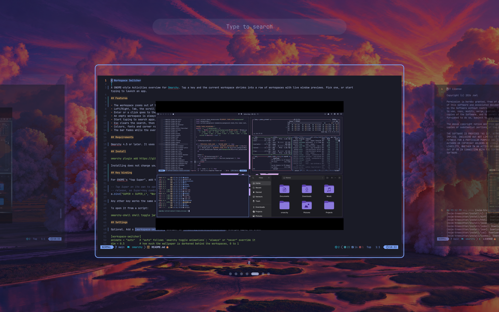

# Workspace Switcher

A GNOME-style Activities overview for [Omarchy](https://omarchy.org/). Tap a key and the current workspace shrinks into a row of workspaces with live window previews. Pick one, or start typing to launch an app.



## Features

- The workspace zooms out of the desktop and back in, window for window.
- Left/Right, Tab, the scroll wheel, a touchpad swipe or a touchscreen swipe move between workspaces.
- Enter or a click goes to the selected workspace. Clicking a window focuses it.
- An empty workspace is always kept at the end to drop into.
- Start typing to search apps. Arrows move, Enter launches.
- Esc clears the search, then closes. Pressing the key again goes to the selected workspace.
- Colours, fonts and corner radius follow the Omarchy theme.
- The bar fades while the overview is open, or stays visible and usable if you prefer.

## Requirements

Omarchy 4.5 or later. It uses only what Omarchy ships; there is nothing else to install.

## Install

```bash
omarchy plugin add https://github.com/janderssn/omarchy-workspace-switcher.git --enable
```

Installing does not change your configuration. To open the overview you add a key binding yourself.

## Key binding

For GNOME's "tap Super", add this to the end of `~/.config/hypr/bindings.lua`:

```lua
-- Tap Super on its own to open or close the workspace switcher. It fires on
-- release, so Super+key combinations keep working.
o.bind("SUPER + SUPER_L", "Workspace switcher", { panel = "janderssn.workspace-switcher" }, { release = true })
```

Any other key works the same way, for example `o.bind("SUPER + TAB", "Workspace switcher", { panel = "janderssn.workspace-switcher" })`.

To open it from a script:

```bash
omarchy-shell shell toggle janderssn.workspace-switcher '{}'
```

## Settings

Optional. Add a `[workspace-switcher]` section to `~/.config/omarchy/shell.toml`; changes apply at once.

```toml
[workspace-switcher]
animate = "auto"   # "auto" follows `omarchy toggle animations`; "always" or "never" override it
dim = 0.5          # how much the wallpaper is darkened behind the workspaces, 0 to 1
bar = "fade"       # "fade" hides the bar while the overview is open; "keep" leaves it showing and usable
```

## What it reads and writes

- It writes no files and makes no network requests.
- It reads the path of the current wallpaper and three Hyprland options (border size and the two border colours).
- While the overview is open it captures the windows on your workspaces, and the bar, to draw the previews. The captures are held in memory only and dropped when it closes.
- It asks Hyprland to focus a workspace or a window when you pick one, and launches the app you choose from search.

## Update

```bash
omarchy plugin update janderssn.workspace-switcher
```

## Remove

```bash
omarchy plugin remove janderssn.workspace-switcher
```

The plugin leaves nothing behind of its own. Two things you added by hand stay until you delete them: the binding line in `~/.config/hypr/bindings.lua` and the `[workspace-switcher]` section in `~/.config/omarchy/shell.toml`.

## Limits

- It shows the workspaces of the focused monitor. Setups with several monitors, rotated monitors and fractional scaling have had little testing.
- Named and special (scratchpad) workspaces are not shown.
- Windows cannot be dragged between workspaces.
- Right-to-left layouts are untested.

## Translations

Strings live in `i18n/<language>.json`, one file per Omarchy language code. A missing language falls back to English. Corrections and new languages are welcome.

## Licence

MIT. See [LICENSE](LICENSE).
